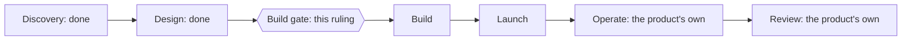
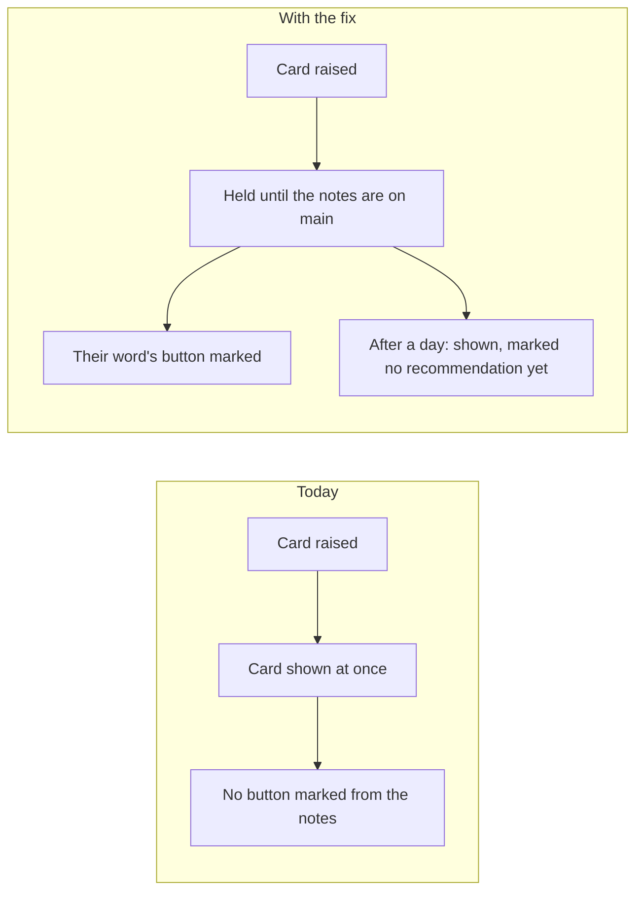
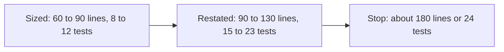
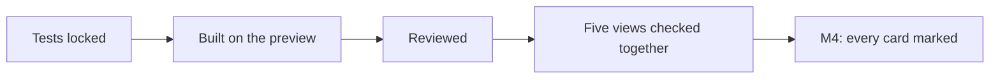
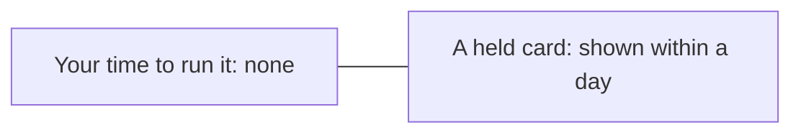

# P-003 — the Build gate

## 1. The ask

The card fix's plan passed its review, nothing blocking [reviews/S-005/plan.md:1] [status/P-003.toml].
Proceeding freezes its criteria and starts the build on the preview; nothing goes live before your Launch gate [docs/projects/P-003.md:42] [docs/projects/P-003.md:88].


*Text alternative: the six phases run Discovery, Design, Build, Launch, Operate and Review, the last two the product's own after it leaves the desk; Discovery and Design are done, and this ruling is the Build gate between Design and Build.*
Where the card fix stands in the six phases [docs/projects/P-003.md:3] [reviews/S-005/plan.md:1] [docs/projects/P-003.md:88]

**The proposer's recommendation:** proceed — the plan passed, costs nothing new, and its one sizable risk, the build's size, has a stop [reviews/S-005/plan.md:1] [reviews/S-005/plan.md:23] [docs/projects/P-003.md:96] [docs/projects/P-003.md:113]

## 2. The vision

Twice you answered a card against an unmarked recommendation [docs/projects/P-003.md:34]; with the fix, a card marks it, or after a day says it has none [docs/projects/P-003.md:46].


*Text alternative: today a card shows at once with no button marked from the notes; with the fix it waits for the notes and marks their word, or after a day shows marked as having no recommendation yet.*
Today against the change [docs/projects/P-003.md:34] [docs/projects/P-003.md:46]

## 3. What this phase taught us

Design's review of the five views side by side found two minor differences, carried below as risks [specs/S-005.md:150] [specs/S-005.md:154] [specs/S-005.md:156] [reviews/S-005/plan.md:11].
The fix grew: now about 90 to 130 lines and 15 to 23 tests, against a stop at about 180 lines or 24 tests [specs/S-005.md:181] [specs/S-005.md:182] [specs/S-005.md:213].


*Text alternative: first sized at 60 to 90 lines and 8 to 12 tests, now restated at 90 to 130 lines and 15 to 23 tests; work stops at about 180 lines or 24 tests.*
Fit against the stop rule [specs/S-005.md:180] [specs/S-005.md:181] [specs/S-005.md:182] [specs/S-005.md:213]

## 4. The plan for the next phase

Tests are locked, the fix is built on the preview and reviewed, then the five views are checked together [docs/projects/P-003.md:68] [docs/projects/P-003.md:71] [docs/projects/P-003.md:84] [docs/projects/P-003.md:87].
Hidden tests and experiments are skipped, by your ruling and the plan [decisions/questions/P-003-hidden-tests.md] [docs/projects/P-003.md:67] [docs/projects/P-003.md:69] [docs/projects/P-003.md:70].


*Text alternative: the tests are locked first, then the fix is built on the preview, reviewed, and checked across the five views, which delivers the one milestone.*
How the deliverables depend on each other [docs/projects/P-003.md:40] [docs/projects/P-003.md:41] [docs/projects/P-003.md:42] [docs/projects/P-003.md:71]

## 5. The risks

The size: the test count may reach the stop; if so, work stops and returns to you [reviews/S-005/plan.md:23] [docs/projects/P-003.md:113].
One notes file that cannot be fetched hides every decision card, with a line saying so [specs/S-005.md:221] [reviews/S-005/plan.md:30].
While a read fails, the board and notifications say nothing; Home and the queue carry the line [specs/S-005.md:154] [specs/S-005.md:223].
A card shown without either mark cannot be counted after launch, only tested before it [specs/S-005.md:222].
One timing fact rests on your earlier ruling; if false, a card could show, then be held [reviews/S-005/plan.md:31].
The freeze may be refused: the evidence check rejects eleven of the spec's facts, which cite plan sections, not lines; a refused freeze returns to you as a card [specs/S-005.md:169] [specs/S-005.md:186].

## 6. Cost and limits

$0 a month new, no new data or service, tier T1 [docs/projects/P-003.md:96] [docs/projects/P-003.md:97] [docs/projects/P-003.md:98].
Your time: none to run it, though you rule the gates, accept M4, and hear of each miss [docs/projects/P-003.md:88] [docs/projects/P-003.md:107].


*Text alternative: the fix takes none of the owner's time to run, and no card is held longer than a day.*
The owner-time caps [docs/projects/P-003.md:107]

## 7. Kill criteria

Work stops and returns to you if the build passes about twice its sizing, or a third plan or build round fails [docs/projects/P-003.md:113] [specs/S-005.md:213]; a miss is a card shown unmarked or held over a day [docs/projects/P-003.md:107].

## 8. What the owner is agreeing to

The spec's criteria, AC1 to AC19, frozen for the build [specs/S-005.md:26] [specs/S-005.md:72].
Build's and Launch's checklist lines: Build-1, Build-3 and Build-4 skipped, the rest taken on [docs/projects/P-003.md:67] [docs/projects/P-003.md:69] [docs/projects/P-003.md:70] [docs/projects/P-003.md:65].
V6, $0, tier T1, unchanged [docs/projects/P-003.md:103] [docs/projects/P-003.md:96] [docs/projects/P-003.md:98].

## 9. Appendix: the phase record
<details>
<summary>The phase record</summary>

Design ran once, with the spec written five times: the first four failed their plan review, three of them stopped and returned to you, and the fifth passed [dispatch-log/2026-11.jsonl] [decisions/P-003/stop-5.md] [decisions/P-003/stop-7.md] [reviews/S-005/plan.md:1].
Your rulings in the phase: the plan's additions, a read without the log, the third review's timing, the Definer's join-up form, and the hidden tests [decisions/questions/P-003-launch-lines.md] [decisions/questions/P-003-log-unread.md] [decisions/questions/P-003-third-review-timing.md] [decisions/questions/definer-join-up-form.md] [decisions/questions/P-003-hidden-tests.md].
Design-4 reads "not reached": the evidence check rejects eleven of the spec's facts, as section 5 says [specs/S-005.md:169] [specs/S-005.md:186].
Design-5 reads "not recorded": no record marks it, though the spec holds the join-up review [specs/S-005.md:147].
Design-6 reads "not recorded" until the spec freezes, which follows this gate [reviews/S-005/plan.md:1].
Design-3, skipped in the plan, reads "not recorded" [docs/projects/P-003.md:60].

```milestones
Design i1
  Design-1 "Done defined in real scenarios": reached
  Design-2 "How the pieces connect is mapped": reached
  Design-3 "Every unknown has a test": not recorded
  Design-4 "Every fact is backed by evidence": not reached
  Design-5 "The design fits together": not recorded
  Design-6 "A plan that passed review": not recorded
    step 2026-11-07T19:53:55Z definer stage 3
    step 2026-11-07T20:08:14Z critic stage 3
    step 2026-11-07T20:40:01Z critic-triage stage 3
    decision 2026-11-07T22:16:19Z stop re-specify
    step 2026-11-07T22:22:34Z definer stage 3
    step 2026-11-07T22:36:22Z critic stage 3
    step 2026-11-08T00:22:00Z definer stage 3
    step 2026-11-08T00:34:09Z critic stage 3
    step 2026-11-08T00:40:05Z definer stage 3
    step 2026-11-08T03:17:11Z critic stage 3
    step 2026-11-08T03:28:18Z critic-triage stage 3
    decision 2026-11-08T13:24:51Z stop criteria-wrong
    step 2026-11-08T13:24:51Z definer stage 3
    step 2026-11-08T13:33:25Z critic stage 3
    step 2026-11-08T13:39:54Z definer stage 3
    step 2026-11-08T13:52:25Z critic stage 3
    step 2026-11-08T16:32:46Z definer stage 3
    step 2026-11-08T16:48:43Z critic stage 3
    step 2026-11-08T16:55:36Z critic-triage stage 3
    decision 2026-11-08T19:17:23Z stop criteria-wrong
    step 2026-11-08T19:23:11Z definer stage 3
    step 2026-11-08T19:39:21Z critic stage 3
    step 2026-11-08T20:27:33Z definer stage 3
    step 2026-11-08T20:34:40Z critic stage 3
```

</details>
