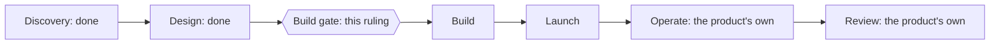
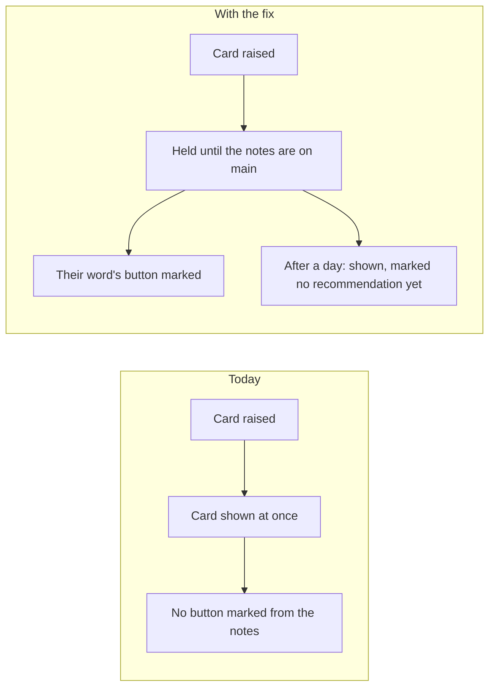
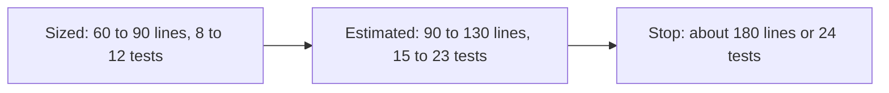
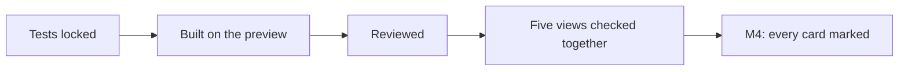
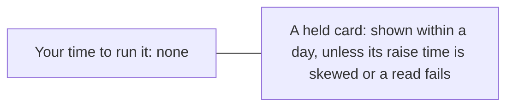

# P-003 — the Build gate

## 1. The ask

Last time this gate was held: the facts cited sections, not lines, so you sent the spec back [reviews/P-003/_build-gate-1-critic.md] [decisions/P-003/criteria-8.md].
Each fact now cites a line, no criterion changed, and the plan passed review again [reviews/S-005/plan.md:1] [reviews/S-005/plan.md:14] [specs/S-005.md:11].
Proceeding freezes the criteria and starts the build on the preview; nothing goes live before your Launch gate [docs/projects/P-003.md:42] [docs/projects/P-003.md:88].


*Text alternative: the six phases run Discovery, Design, Build, Launch, Operate and Review, the last two the product's own after it leaves the desk; Discovery and Design are done, and this ruling is the Build gate between Design and Build.*
Where the card fix stands in the six phases [docs/projects/P-003.md:3] [reviews/S-005/plan.md:1] [docs/projects/P-003.md:88]

**The proposer's recommendation:** proceed — the plan passed, its facts cite lines, and the build's size has a stop [reviews/S-005/plan.md:1] [reviews/S-005/plan.md:14] [docs/projects/P-003.md:96] [docs/projects/P-003.md:113]

## 2. The vision

Twice you answered a card against an unmarked recommendation [docs/projects/P-003.md:34]; with the fix, a card marks it, or after a day says it has none [docs/projects/P-003.md:46].


*Text alternative: today a card shows at once with no button marked from the notes; with the fix it waits for the notes and marks their word, or after a day shows marked as having no recommendation yet.*
Today against the change [docs/projects/P-003.md:34] [docs/projects/P-003.md:46]

## 3. What this phase taught us

Design's review of the five views found two minor differences, carried below as risks [specs/S-005.md:150] [specs/S-005.md:154] [specs/S-005.md:156].
P-003 has no design files, so no screen thumbnails [specs/S-005.md:150].
The Definer estimates, unmeasured, 90 to 130 lines and 15 to 23 tests; the stop is about 180 lines or 24 tests [specs/S-005.md:180] [specs/S-005.md:181] [specs/S-005.md:182] [specs/S-005.md:213].


*Text alternative: first sized at 60 to 90 lines and 8 to 12 tests, now estimated, not measured, at 90 to 130 lines and 15 to 23 tests; work stops at about 180 lines or 24 tests.*
Fit against the stop rule [specs/S-005.md:180] [specs/S-005.md:181] [specs/S-005.md:182] [specs/S-005.md:213]

## 4. The plan for the next phase

Tests are locked, then the fix is built on the preview, reviewed, and checked across the five views [docs/projects/P-003.md:68] [docs/projects/P-003.md:71] [docs/projects/P-003.md:84] [docs/projects/P-003.md:87].


*Text alternative: the tests are locked first, then the fix is built on the preview, reviewed, and checked across the five views, which delivers the one milestone.*
How the deliverables depend on each other [docs/projects/P-003.md:40] [docs/projects/P-003.md:41] [docs/projects/P-003.md:42] [docs/projects/P-003.md:71]

## 5. The risks

Size: the test estimate fits only if tests are shared; past the stop, work returns to you [reviews/S-005/plan.md:34] [docs/projects/P-003.md:113].
One unreadable notes file hides every decision card, with a line saying so [specs/S-005.md:199] [specs/S-005.md:221].
While a read fails, the board and notifications say nothing; Home and the queue do [specs/S-005.md:154] [specs/S-005.md:223].
The mark's type and spacing are not fixed; the Builder uses existing styles [specs/S-005.md:156].
A card shown with neither mark is tested before launch, not counted after [specs/S-005.md:222] [reviews/S-005/plan.md:35].
A skewed raise time can hold a card past a day; it is reported beside V6, not in it [specs/S-005.md:197] [specs/S-005.md:220].

## 6. Cost and limits

$0 a month new, no new data or service, tier T1 [docs/projects/P-003.md:96] [docs/projects/P-003.md:97] [docs/projects/P-003.md:98].
Your time: none to run it; you rule the gates, accept M4 and hear of each miss [docs/projects/P-003.md:88] [docs/projects/P-003.md:107].


*Text alternative: the fix takes none of the owner's time to run; a held card shows within a day of being raised, except when its recorded raise time is skewed or malformed, or while a read fails.*
The owner-time caps [docs/projects/P-003.md:107] [docs/projects/P-003.md:109] [specs/S-005.md:197]

## 7. Kill criteria

Work stops and returns to you if the build passes about twice its sizing, a third readiness, plan-review or build round fails, or it needs the sender's files changed [docs/projects/P-003.md:113] [specs/S-005.md:213].
A miss: a card shown with neither mark, or held over a day after being raised [docs/projects/P-003.md:107].

## 8. What the owner is agreeing to

The spec's criteria, AC1 to AC19, frozen for the build [specs/S-005.md:26] [specs/S-005.md:72].
Build's and Launch's checklist lines: Build-1, Build-3 and Build-4 skipped, the rest taken on [docs/projects/P-003.md:65] [docs/projects/P-003.md:67] [docs/projects/P-003.md:69] [docs/projects/P-003.md:70].
V6, $0, tier T1, unchanged [docs/projects/P-003.md:103] [docs/projects/P-003.md:96] [docs/projects/P-003.md:98].

## 9. Appendix: the phase record
<details>
<summary>The phase record</summary>

Design's first iteration ended at this gate's first case, which the gate Critic advised holding [docs/gates/P-003/build-gate-1-case.md] [reviews/P-003/_build-gate-1-critic.md].
You recycled it into Design so the Definer would cite each fact by line and change no criterion [decisions/P-003/criteria-8.md].
In the second iteration the Definer changed only the citations, and the plan review passed [specs/S-005.md:11] [reviews/S-005/plan.md:1] [reviews/S-005/plan.md:14].
The plan review's one open question, whether the spec stayed within "do not grow", it could not check [reviews/S-005/plan.md:40].
Your rulings in the phase: the plan's additions, a read without the log, the third review's timing, the Definer's join-up form, the hidden tests, and the recycle [decisions/questions/P-003-launch-lines.md] [decisions/questions/P-003-log-unread.md] [decisions/questions/P-003-third-review-timing.md] [decisions/questions/definer-join-up-form.md] [decisions/questions/P-003-hidden-tests.md] [decisions/P-003/criteria-8.md].
Design-4 now reads "reached": each fact cites a line [reviews/S-005/plan.md:14].
Design-5 reads "not recorded": no record marks it, though the spec holds the join-up review [specs/S-005.md:147].
Design-6 reads "not recorded" until the spec freezes, which follows this gate [reviews/S-005/plan.md:1].
Design-3, skipped in the plan, reads "not recorded" [docs/projects/P-003.md:60].

```milestones
Design i2
  Design-1 "Done defined in real scenarios": reached
  Design-2 "How the pieces connect is mapped": reached
  Design-3 "Every unknown has a test": not recorded
  Design-4 "Every fact is backed by evidence": reached
  Design-5 "The design fits together": not recorded
  Design-6 "A plan that passed review": not recorded
    step 2026-11-08T23:06:57Z definer stage 3
    step 2026-11-08T23:19:58Z critic stage 3
```

</details>
