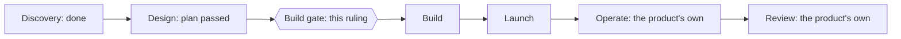
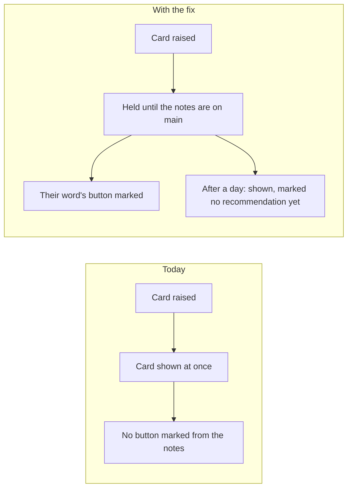
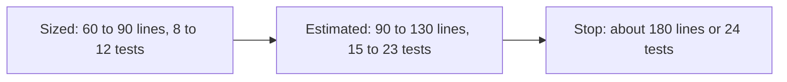
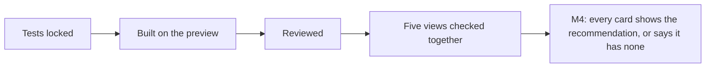
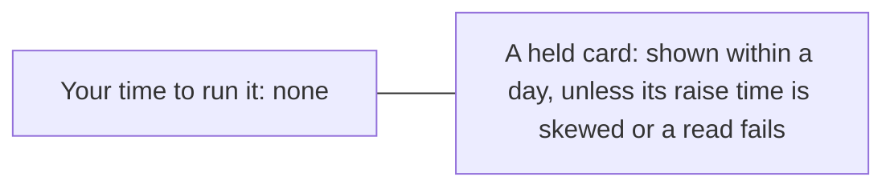

# P-003 — the Build gate

## 1. The ask

Last time you proceeded; the locked tests then failed review, and you kept the criteria [decisions/P-003/criteria-9.md:1] [decisions/P-003/stop-11.md:3].
The carried spec then failed its plan review, partly on two old slips in AC13 [decisions/questions/P-003-critic-superseded-specs.md] [decisions/P-003/stop-12.md:1].
The new spec changes only AC13, and its plan passed [specs/S-007.md:11] [reviews/S-007/plan.md:1] [reviews/S-007/plan.md:7].
Proceeding freezes the criteria and starts the locked tests, then the build on the preview; nothing goes live before Launch [docs/projects/P-003.md:42] [docs/projects/P-003.md:88].


*Text alternative: the six phases run Discovery, Design, Build, Launch, Operate and Review, the last two the product's own after it leaves the desk; Discovery is done, Design's plan passed review, and this ruling is the Build gate between Design and Build.*
Where the card fix stands in the six phases [docs/projects/P-003.md:3] [reviews/S-007/plan.md:1] [docs/projects/P-003.md:88]

**The proposer's recommendation:** proceed — the plan passed, only AC13 changed, and the build has a stop [reviews/S-007/plan.md:1] [reviews/S-007/plan.md:7] [decisions/P-003/stop-12.md:3] [docs/projects/P-003.md:113]

## 2. The vision

Twice you answered a card against an unmarked recommendation [docs/projects/P-003.md:34]; with the fix, a card marks it, or after a day says it has none [docs/projects/P-003.md:46].


*Text alternative: today a card shows at once with no button marked from the notes; with the fix it waits for the notes and marks their word, or after a day shows marked as having no recommendation yet.*
Today against the change [docs/projects/P-003.md:34] [docs/projects/P-003.md:46]

## 3. What this phase taught us

Two reading gaps, not the criteria, cost this phase its rounds; both are fixed [decisions/P-003/stop-11.md:3] [decisions/questions/P-003-critic-superseded-specs.md].
AC13 now names three sample cards and case (a)'s reference time [specs/S-007.md:45] [specs/S-007.md:46] [specs/S-007.md:48].
Design's two minor differences are unchanged [specs/S-007.md:154] [specs/S-007.md:156].
The estimate, unmeasured, is still 90 to 130 lines and 15 to 23 tests; the stop is about 180 lines or 24 tests [specs/S-007.md:181] [specs/S-007.md:182] [specs/S-007.md:213].


*Text alternative: first sized at 60 to 90 lines and 8 to 12 tests, now estimated, not measured, at 90 to 130 lines and 15 to 23 tests; work stops at about 180 lines or 24 tests.*
Fit against the stop rule [specs/S-007.md:180] [specs/S-007.md:181] [specs/S-007.md:182] [specs/S-007.md:213]

## 4. The plan for the next phase

Tests are locked, then the fix is built on the preview, reviewed, and checked across the five views [docs/projects/P-003.md:84] [docs/projects/P-003.md:87] [docs/projects/P-003.md:71].


*Text alternative: the tests are locked first, then the fix is built on the preview, reviewed, and checked across the five views, which delivers the one milestone.*
How the deliverables depend on each other [docs/projects/P-003.md:42] [docs/projects/P-003.md:46] [docs/projects/P-003.md:71]

## 5. The risks

Size: 23 tests is one below the stop; past it, work returns to you [specs/S-007.md:182] [docs/projects/P-003.md:113].
Today's behaviour is unchecked until Build's baseline runs; a sender change stops the build [specs/S-007.md:190] [specs/S-007.md:209] [reviews/S-007/plan.md:28].
One unreadable notes file hides every decision card, saying so [specs/S-007.md:201] [specs/S-007.md:221].
During a failed read, only Home and the queue say so [specs/S-007.md:154] [specs/S-007.md:223].
The mark's type and spacing follow existing styles [specs/S-007.md:156].
A card shown with neither mark is tested before launch, not counted after [specs/S-007.md:222].
A skewed raise time can hold a card past a day, reported beside V6 [specs/S-007.md:197] [specs/S-007.md:220].

## 6. Cost and limits

$0 a month new, no new data or service, tier T1 [docs/projects/P-003.md:96] [docs/projects/P-003.md:97] [docs/projects/P-003.md:98].
Your time: none to run it; you rule gates, accept M4 and hear of misses [docs/projects/P-003.md:88] [docs/projects/P-003.md:107].


*Text alternative: the fix takes none of the owner's time to run; a held card shows within a day of being raised, except when its recorded raise time is skewed or malformed, or while a read fails.*
The owner-time caps [docs/projects/P-003.md:107] [docs/projects/P-003.md:109] [specs/S-007.md:197]

## 7. Kill criteria

Work returns to you if the build passes about twice its sizing, a third round fails, or the sender needs changing [docs/projects/P-003.md:113] [specs/S-007.md:213].
A miss: a card shown with neither mark, or held over a day after being raised [docs/projects/P-003.md:107].

## 8. What the owner is agreeing to

The spec's criteria, AC1 to AC19, frozen for the build [specs/S-007.md:26] [specs/S-007.md:72].
Build's and Launch's checklist lines: Build-1, Build-3 and Build-4 skipped, the rest taken on [docs/projects/P-003.md:65] [docs/projects/P-003.md:67] [docs/projects/P-003.md:69] [docs/projects/P-003.md:70] [docs/projects/P-003.md:72] [docs/projects/P-003.md:76].
V6, $0, tier T1, unchanged [docs/projects/P-003.md:103] [docs/projects/P-003.md:96] [docs/projects/P-003.md:98].

## 9. Appendix: the phase record
<details>
<summary>The phase record</summary>

After the second case you proceeded, and S-005 froze [decisions/P-003/criteria-9.md:1].
Its locked tests failed the Critic three times; the Check author's pack lacked the tests, fixed by your ruling [decisions/P-003/stop-11.md:3] [decisions/questions/P-003-check-author-pack.md].
You ruled `checks-wrong`: S-006 carried S-005 unchanged [decisions/P-003/stop-11.md:1].
S-006 failed its plan review three times: the Critic's pack lacked S-005, fixed by your ruling, and AC13 held two slips already in S-005 [decisions/questions/P-003-critic-superseded-specs.md].
You ruled `criteria-wrong`, fixing AC13 only [decisions/P-003/stop-12.md:1] [decisions/P-003/stop-12.md:3].
S-007's first plan review failed on one unlisted line in its change note; the second passed [specs/S-007.md:11] [reviews/S-007/plan.md:1].
Your other ruling in the phase: the loop's timer gaps raised in the operating model [decisions/questions/orchestrator-schedule-gaps.md].

```milestones
Design i2
  Design-1 "Done defined in real scenarios": reached
  Design-2 "How the pieces connect is mapped": reached
  Design-3 "Every unknown has a test": not recorded
  Design-4 "Every fact is backed by evidence": reached
  Design-5 "The design fits together": not recorded
  Design-6 "A plan that passed review": not recorded
    step 2026-11-08T23:06:57Z definer stage 3
    step 2026-11-08T23:19:58Z critic stage 3
    step 2026-11-09T00:10:53Z critic-gate stage 3
    decision 2026-11-09T01:11:22Z criteria proceed
    step 2026-11-09T01:17:21Z definer-freeze stage 3
    step 2026-11-09T20:25:06Z definer stage 3
    step 2026-11-09T20:39:00Z critic stage 3
    step 2026-11-09T20:56:08Z definer stage 3
    step 2026-11-09T21:09:23Z critic stage 3
    step 2026-11-10T03:14:20Z definer stage 3
    step 2026-11-10T03:21:18Z critic stage 3
    step 2026-11-10T03:34:20Z critic-triage stage 3
    decision 2026-11-10T12:53:25Z stop criteria-wrong
    step 2026-11-10T12:53:25Z definer stage 3
    step 2026-11-10T13:06:43Z critic stage 3
    step 2026-11-10T13:20:07Z definer stage 3
    step 2026-11-10T19:19:22Z critic stage 3
```

</details>
