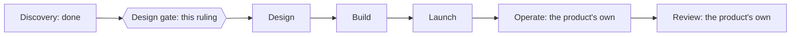
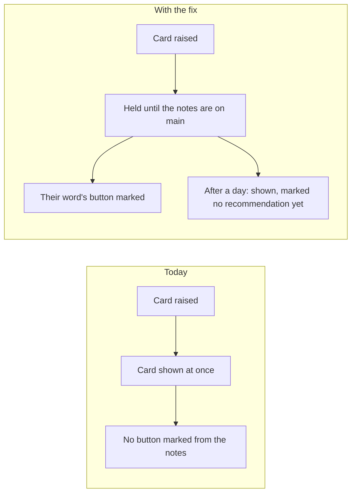
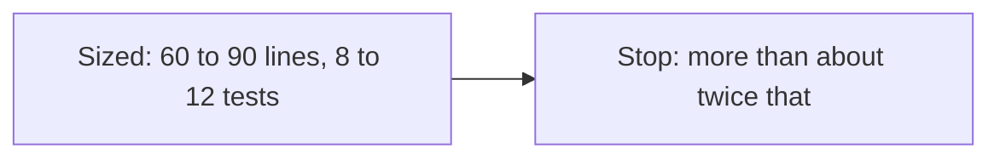
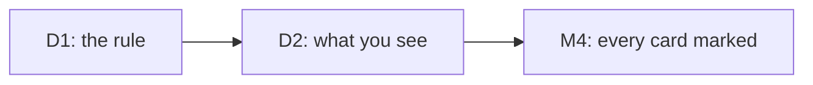
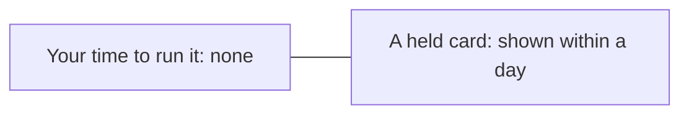

# P-003 — the Design gate

## 1. The ask

The card fix passed its readiness check [reviews/P-003/_critic-dor.md]; you held case 1 to fix its form [decisions/P-003/dor-3.md].
Proceeding settles the brief and moves it into Design [docs/projects/P-003.md:3]; nothing is built before the Build gate, which you rule [docs/projects/P-003.md:61] [docs/projects/P-003.md:71].


*Text alternative: the six phases run Discovery, Design, Build, Launch, Operate and Review, the last two the product's own after it leaves the desk; Discovery is done, and this ruling is the Design gate between Discovery and Design.*
Where the card fix stands in the six phases [docs/design/references/comments-2026-10.md:31] [docs/design/references/comments-2026-10.md:32] [docs/projects/P-003.md:3] [docs/projects/P-003.md:71] [reviews/P-003/_critic-dor.md]

**The proposer's recommendation:** proceed — the brief is ready, costs nothing new, and each risk has an answer [reviews/P-003/_critic-dor.md] [docs/projects/P-003.md:79] [docs/projects/P-003.md:102] [docs/projects/P-003.md:103] [docs/projects/P-003.md:104] [docs/projects/P-003.md:105]

## 2. The vision

Twice you answered a card against an unmarked recommendation [docs/projects/P-003.md:32]; with the fix, a card marks it, or after a day says it has none [docs/projects/P-003.md:44].


*Text alternative: today a card shows at once with no button marked from the notes; with the fix it waits for the notes and marks their word, or after a day shows marked as having no recommendation yet.*
Today against the change [docs/projects/P-003.md:32] [docs/projects/P-003.md:44]

## 3. What this phase taught us

One list feeds every view, so the hold is one rule; the change is small, though its sizing was briefed from the plan's first draft, so not independent of it [docs/projects/P-003.md:97] [docs/projects/P-003.md:99].


*Text alternative: the sizing is 60 to 90 lines and 8 to 12 tests; work stops if the build grows past about twice that.*
Fit against the stop rule [docs/projects/P-003.md:92]

## 4. The plan for the next phase

Design writes the behaviour as scenarios, maps how the five views join, cites every fact about the code, checks the views side by side, and ends with a reviewed spec; it skips the experiment [docs/projects/P-003.md:56] [docs/projects/P-003.md:57] [docs/projects/P-003.md:58] [docs/projects/P-003.md:59] [docs/projects/P-003.md:60] [docs/projects/P-003.md:61].


*Text alternative: the rule comes first, what the owner sees depends on it, and both deliver the one milestone.*
How the deliverables depend on each other [docs/projects/P-003.md:38] [docs/projects/P-003.md:39] [docs/projects/P-003.md:40]

## 5. The risks

Each risk is answered by a rule in the brief, which Design turns into scenarios [docs/projects/P-003.md:56] [docs/projects/P-003.md:101]:
A card held for good: after a day it shows [docs/projects/P-003.md:102].
A wrong button marked: notes without a word count as none [docs/projects/P-003.md:103].
You are told twice: a held card's notification goes only when it shows [docs/projects/P-003.md:104].
A gate card changed: gate cards stay as they are [docs/projects/P-003.md:105].

## 6. Cost and limits

$0 a month new, no new data or service, tier T1 [docs/projects/P-003.md:79] [docs/projects/P-003.md:80] [docs/projects/P-003.md:81].
Your time: none to run it, though you rule the three gates, accept M4, and hear of each miss [docs/projects/P-003.md:71] [docs/projects/P-003.md:90].
Usage so far: the one helper run recorded, 91,414 tokens [research/P-003-sizing-findings.md:3].


*Text alternative: the fix takes none of the owner's time to run, and no card is held longer than a day.*
The owner-time caps [docs/projects/P-003.md:90]

## 7. Kill criteria

Work stops and returns to you if the build passes about twice its sizing, or a third readiness or plan-review round fails [docs/projects/P-003.md:92]; a miss is a card shown unmarked or held over a day [docs/projects/P-003.md:90].

## 8. What the owner is agreeing to

M4, "Every decision card shows the Chief of Staff's recommendation, or says it has none", a Build milestone, as its line stands, quoted whole in the appendix [docs/projects/P-003.md:44].
Its target: no card shown unmarked, from go-live to 31 December 2026 [docs/projects/P-003.md:86].
The standard lines, ruled again at this gate: eleven taken on, and Discovery-3, Discovery-4 and Design-3 skipped [decisions/questions/P-003-standard-lines.md:19] [reviews/P-003/_critic-dor.md] [docs/projects/P-003.md:50] [docs/projects/P-003.md:51] [docs/projects/P-003.md:58].
$0, tier T1 [docs/projects/P-003.md:79] [docs/projects/P-003.md:81].

## 9. Appendix: the phase record
<details>
<summary>The phase record</summary>

Discovery ran once: four readiness runs; the first stopped on an error, the next two failed and were answered resubmit (the second by the Chief of Staff at your request), the fourth passed [dispatch-log/2026-11.jsonl] [decisions/P-003/dor-fail-1.md] [decisions/P-003/dor-fail-2.md] [reviews/P-003/_critic-dor.md].
Case 1 was read by the gate Critic, which found its form broken (length, visuals, M4 not shown) and three weak citations; you held it, and this case answers each finding [reviews/P-003/_design-gate-1-critic.md] [decisions/P-003/dor-3.md].
M4's line, as you are asked to approve it [docs/projects/P-003.md:44]:

> Every decision card shows the Chief of Staff's recommendation, or says it has none (M4) · done when a decision card waits off the owner's queue until the Chief of Staff's notes for it are on the main branch, then shows with the notes' recommended answer and that answer's button marked Recommended, and, if no notes have arrived a day after it was raised, shows anyway marked "No Chief of Staff recommendation yet", gate cards staying as they are, and a card shown that way takes the recommendation once the notes arrive, on the desk's preview, with its tests · phase: Build · why: twice the owner answered a decision card `re-specify` where the Chief of Staff's notes recommended `drop`, and the desk marks an answer as recommended only from the card itself and never reads the notes [docs/projects/P-003.md:44]

Your rulings in the phase: the Critic's size limit raised, the plan's place, the standard lines, and the hold [decisions/questions/P-003-critic-pack-cap.md] [decisions/questions/P-003-plan-place.md] [decisions/questions/P-003-standard-lines.md] [decisions/P-003/dor-3.md].
Discovery-1 and Discovery-6 were taken on but read "not recorded": the plan takes them on, but no record marks them reached [docs/projects/P-003.md:48] [docs/projects/P-003.md:53].
The two steps skipped by your ruling show as not reached and not recorded [docs/projects/P-003.md:50] [docs/projects/P-003.md:51].

```milestones
Discovery i1
  Discovery-1 "An idea worth exploring": not recorded
  Discovery-2 "Success defined": reached
  Discovery-3 "The expert's questions answered": not reached
  Discovery-4 "The right problem chosen": not recorded
  Discovery-5 "What already exists is known": reached
  Discovery-6 "The risks are known": not recorded
  Discovery-7 "Scope, limits and owners agreed": reached
  Discovery-8 "A brief ready to rule on": reached
    step 2026-11-04T16:38:43Z critic stage 2
    step 2026-11-04T20:27:40Z critic stage 2
    decision 2026-11-04T20:43:51Z dor-fail resubmit
    step 2026-11-04T20:43:51Z critic stage 2
    decision 2026-11-05T16:25:24Z dor-fail resubmit
    step 2026-11-05T16:30:02Z critic stage 2
    step 2026-11-06T16:16:56Z critic-gate stage 2
```

</details>
