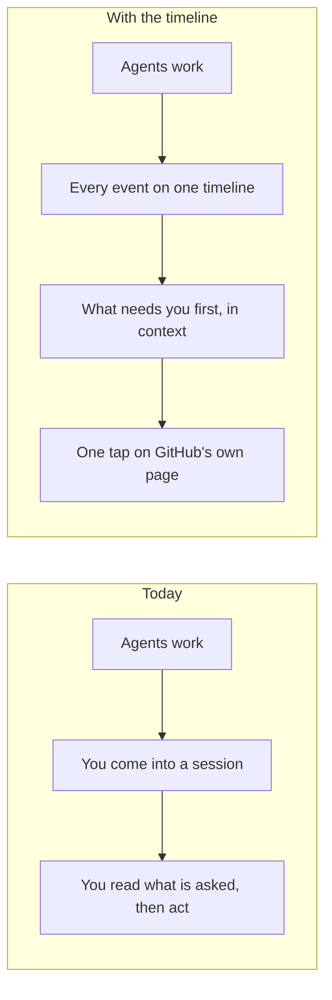
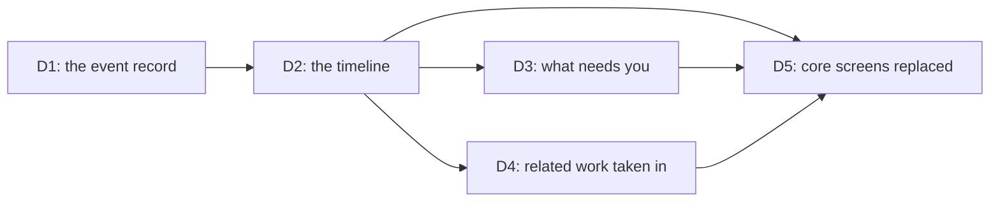
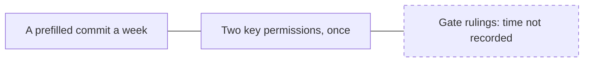

# P-005 — the Design gate

## 1. The ask

The timeline puts all the agents' work, and what needs you, in one view [docs/projects/P-005.md:73] [docs/projects/P-005.md:74]. Its brief passed its readiness check after one fail, resubmitted by the Chief of Staff under your standing proxy [reviews/P-005/_critic-dor.md] [decisions/P-005/dor-fail-1.md].
Proceeding moves it into Design [docs/projects/P-005.md:95].
Two Discovery steps read not reached below, though their research passed its source checks [research/Q-022-source-check.md] [research/Q-027-source-check.md].


*Text alternative: the six phases run Discovery, Design, Build, Launch, Operate and Review, the last two the product's own after launch; Discovery's brief has passed, and this ruling is the gate between Discovery and Design.*
Where the timeline stands [docs/design/references/comments-2026-10.md:31] [docs/design/references/comments-2026-10.md:32] [reviews/P-005/_critic-dor.md]

**The proposer's recommendation:** proceed — Design needs no new spend, and each unknown has a test or comes back to you [docs/projects/P-005.md:119] [docs/projects/P-005.md:158] [docs/projects/P-005.md:159] [docs/projects/P-005.md:180] [docs/projects/P-005.md:186]

## 2. The vision

Today things wait on you too long [docs/projects/P-005.md:56].


*Text alternative: today the owner learns what waits by coming into a session and reading what is asked; with the timeline every event shows on one view, what needs the owner first and in its context, finished with one tap on GitHub's own page.*
Today against the change [docs/projects/P-005.md:56] [docs/projects/P-005.md:74]

## 3. What this phase taught us

Today's read key cannot read check marks on your two private repositories [docs/projects/P-005.md:121] [docs/projects/P-005.md:181] [docs/projects/P-005.md:187].
No source read sets a daily alert limit; the paid standards were not read [docs/projects/P-005.md:151].

## 4. The plan for the next phase

Design writes scenarios, maps joins, measures today's waits, tests the records (M6) and ends with a reviewed plan; no dates are recorded [docs/projects/P-005.md:72] [docs/projects/P-005.md:90] [docs/projects/P-005.md:91] [docs/projects/P-005.md:92] [docs/projects/P-005.md:93] [docs/projects/P-005.md:94] [docs/projects/P-005.md:95].


*Text alternative: the event record comes first; the timeline needs it; what needs the owner and the related work each need the timeline; replacing the core screens needs all of them. M6 settles D1, M7 delivers D2, M8 D3, M9 D4 and M10 D5.*
How the deliverables depend on each other [docs/projects/P-005.md:62] [docs/projects/P-005.md:63] [docs/projects/P-005.md:64] [docs/projects/P-005.md:65] [docs/projects/P-005.md:66] [docs/projects/P-005.md:68]

## 5. The risks

Halving waits may be out of reach: they come mostly from your busyness [docs/projects/P-005.md:56] [docs/projects/P-005.md:128].
Results past 90 days are lost until you approve a copying job of unknown cost; research Q-028 awaits its source check [docs/projects/P-005.md:182] [dispatch-log/2026-11.jsonl].
A stopped view may look quiet; its check comes in Design [docs/projects/P-005.md:186].

## 6. Cost and limits

$0 a month new; T1, read-only [docs/projects/P-005.md:119] [docs/projects/P-005.md:121].
Your time: a weekly prefilled commit, two key permissions, the gates [docs/projects/P-005.md:139] [docs/projects/P-005.md:121] [docs/projects/P-005.md:187] [docs/projects/P-005.md:112].
Usage so far: not recorded [dispatch-log/2026-11.jsonl].


*Text alternative: the timeline costs the owner one prefilled commit a week and adding two permissions to the read key once; the time the gate rulings take is not recorded, drawn dashed.*
Your time [docs/projects/P-005.md:139] [docs/projects/P-005.md:121]

## 7. Kill criteria

Work stops if a step waiting on you, or any of the eleven kinds, has no record of its time and who; acting needs unapproved spend or keys; today's waits number under 10 in 30 days or their median is under an hour; alert research conflicts with your answer; the build outgrows a ceiling Design sets; or a third review fails [docs/projects/P-005.md:141].

## 8. What the owner is agreeing to

Milestones M6 to M10: records proven, one timeline, your needs first, related work in, the timeline as the desk; and fourteen standard steps [docs/projects/P-005.md:72] [docs/projects/P-005.md:73] [docs/projects/P-005.md:74] [docs/projects/P-005.md:75] [docs/projects/P-005.md:76] [docs/projects/P-005.md:82] [docs/projects/P-005.md:95].
Draft targets, misses, costs and stop thresholds: waits halved, none unseen, none shown wrongly [docs/projects/P-005.md:126] [docs/projects/P-005.md:128] [docs/projects/P-005.md:129] [docs/projects/P-005.md:130].
Also [docs/projects/P-005.md:190]: $0, T1 and sending pull-request text to an outside AI; paying for alarm standards; alerts within 5 minutes; record changes during Design; the briefing page built here; deploy approvals; four model steps as new kinds; whether proxy actions count; counting steps hidden by a stopped view apart; no week's trial; resting on single GitHub pages; the Intent.

## 9. Appendix: the phase record
<details>
<summary>The phase record</summary>

Discovery ran once: two readiness runs (the timeline's block below ends at the second run's dispatch, before its PASS); the first failed and was answered resubmit by the Chief of Staff after two passing dry runs, the second passed [dispatch-log/2026-11.jsonl] [decisions/P-005/dor-fail-1.md] [reviews/P-005/_critic-dor.md].
Your rulings in the phase: the route, the groundwork shortlist, acting, reading, lasting copies and the experiments [decisions/questions/P-005-route.md] [decisions/questions/P-005-groundwork-shortlist.md] [decisions/questions/P-005-acting.md] [decisions/questions/P-005-reading.md] [decisions/questions/P-005-lasting-copies.md] [decisions/questions/P-005-experiments.md] [decisions/questions/P-005-vendor-pages.md].
The readiness check's note: M7's reach back through the whole life of the work depends on the copying job, and the plan says M7 then shows older results as no longer kept [reviews/P-005/_critic-dor.md] [docs/projects/P-005.md:182].
Discovery-3 and Discovery-5 read not reached on the timeline, though the groundwork map and the five research memos are filed and source-checked, some after several rounds [research/Q-022-source-check.md] [research/Q-023-source-check.md] [research/Q-024-source-check.md] [research/Q-025-source-check.md] [research/Q-026-source-check.md] [research/Q-027-source-check.md] [dispatch-log/2026-11.jsonl] [docs/projects/P-005.md:84] [docs/projects/P-005.md:86]; Discovery-4 and Discovery-6 read not recorded, as no record marks them reached [docs/projects/P-005.md:85] [docs/projects/P-005.md:87].

```milestones
Discovery i1
  Discovery-1 "An idea worth exploring": not recorded
  Discovery-2 "Success defined": reached
  Discovery-3 "The expert's questions answered": not reached
  Discovery-4 "The right problem chosen": not recorded
  Discovery-5 "What already exists is known": not reached
  Discovery-6 "The risks are known": not recorded
  Discovery-7 "Scope, limits and owners agreed": reached
  Discovery-8 "A brief ready to rule on": reached
    step 2026-11-13T03:44:04Z critic stage 2
    decision 2026-11-13T04:48:18Z dor-fail resubmit
    step 2026-11-13T04:48:18Z critic stage 2
```

</details>
